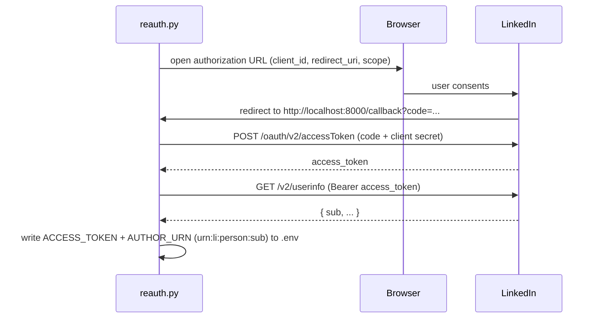

# External API Reference

GateKeep integrates with two external HTTP APIs. Both are called directly over
HTTPS (no MCP, no SDK for LinkedIn; the official SDK for Gemini). This document
covers the exact requests, auth, versioning, and error handling.

- [LinkedIn](#linkedin-api) — OAuth token acquisition and post publishing.
- [Gemini](#gemini-api) — draft generation.

---

## LinkedIn API

Two flows: a one-time (per ~60 days) **OAuth flow** in `reauth.py` to obtain a
token and the author URN, and the **Posts API** in `linkedin_client.py` to
publish.

### Auth model

- **Product / scope:** LinkedIn "Share on LinkedIn" (`w_member_social`) plus
  `openid` and `profile` for identity.
- **Token type:** member access token (Bearer). Expires roughly every 60 days;
  refresh by re-running `python reauth.py`.
- **Author identity:** posts are authored as a member URN,
  `urn:li:person:{sub}`, where `sub` comes from the OpenID `userinfo` endpoint.

Both values live in `.env`:

```
LINKEDIN_ACCESS_TOKEN=...
LINKEDIN_AUTHOR_URN=urn:li:person:AbC123
```

### OAuth flow (`reauth.py`)



Endpoints used:

| Step | Method + URL |
|---|---|
| Authorize | `GET https://www.linkedin.com/oauth/v2/authorization` |
| Token exchange | `POST https://www.linkedin.com/oauth/v2/accessToken` |
| Identity | `GET https://api.linkedin.com/v2/userinfo` |

The local callback server binds **both IPv4 and IPv6 loopback** (Windows often
resolves `localhost` to `::1` first) and keeps serving until the request
carrying `?code=` arrives, tolerating stray favicon/prefetch requests.

Required `.env` inputs for this flow: `LINKEDIN_CLIENT_ID`,
`LINKEDIN_CLIENT_SECRET`, and optionally `LINKEDIN_REDIRECT_URI`
(default `http://localhost:8000/callback`).

### Publishing a post (`linkedin_client.publish_text`)

**Endpoint:** `POST https://api.linkedin.com/rest/posts`

**Headers:**

| Header | Value |
|---|---|
| `Authorization` | `Bearer {access_token}` |
| `Content-Type` | `application/json` |
| `X-Restli-Protocol-Version` | `2.0.0` |
| `LinkedIn-Version` | `YYYYMM` (see versioning below) |

**Request body:**

```json
{
  "author": "urn:li:person:AbC123",
  "commentary": "escaped post text",
  "visibility": "PUBLIC",
  "distribution": {
    "feedDistribution": "MAIN_FEED",
    "targetEntities": [],
    "thirdPartyDistributionChannels": []
  },
  "lifecycleState": "PUBLISHED",
  "isReshareDisabledByAuthor": false
}
```

**Success:** HTTP `200`/`201`. The new post id is returned in the
**`x-restli-id` response header** (e.g. `urn:li:share:...`), which GateKeep
stores as `linkedin_post_id`. A missing header is treated as an error.

#### Commentary escaping

LinkedIn's `commentary` field is "Little Text Format". These reserved characters
must be backslash-escaped or the text is truncated/mangled at them:

```
\ | { } @ [ ] ( ) < > * _ ~
```

`_escape_commentary()` escapes each of these. **`#` is intentionally left
unescaped** so hashtags stay clickable. Example:

```
see (this) and #tag   →   see \(this\) and #tag
```

#### API versioning and fallback

LinkedIn retires dated API versions (`YYYYMM`) roughly yearly. `publish_text`
handles this:

1. Try the **primary** version: `LINKEDIN_API_VERSION` from `.env`, else
   `DEFAULT_LINKEDIN_VERSION` (`202606`).
2. If LinkedIn responds `426` with `NONEXISTENT_VERSION`, the version is retired
   and **nothing was posted** — safe to retry the next version.
3. Walk `FALLBACK_VERSIONS` (`202607, 202606, 202605, 202603, 202601, 202509`),
   primary de-duplicated to the front.
4. If **every** version is retired, raise `LinkedInError` asking the user to set
   a current `LINKEDIN_API_VERSION`.

Any non-version error (e.g. `403`, expired token) raises `LinkedInError`
**immediately** without retrying.

> Maintenance: when all listed versions eventually lapse, refresh
> `DEFAULT_LINKEDIN_VERSION` and `FALLBACK_VERSIONS` in `linkedin_client.py`.

#### Error handling summary

| Condition | Behavior |
|---|---|
| `200` / `201` + `x-restli-id` | Return the post URN |
| `200` / `201`, no `x-restli-id` | Raise `LinkedInError` (missing header) |
| `426 NONEXISTENT_VERSION` | Retry next version; nothing posted |
| Any other non-2xx | Raise `LinkedInError` with status + truncated body |
| Network exception | Raise `LinkedInError` (wrapped `requests.RequestException`) |
| All versions retired | Raise `LinkedInError` (set a current version) |

On failure during a scheduled/on-demand publish, the post is **left approved**
for retry (see [architecture.md](architecture.md)).

---

## Gemini API

**Client:** `gemini_client.generate_draft()` via the `google-generativeai` SDK.

| Property | Value |
|---|---|
| Model | `gemini-2.5-flash` |
| Auth | `GEMINI_API_KEY` in `.env` (Google AI Studio, free tier) |
| Call | `genai.GenerativeModel(MODEL_NAME, system_instruction=...).generate_content(prompt)` |

### Request shape

- **`system_instruction`** — the fixed persona + voice + honesty rules
  (`SYSTEM_INSTRUCTION`).
- **`prompt`** — the selected pillar's template (`PILLAR_PROMPTS[pillar]`), with
  optional user context appended:

  ```
  {pillar prompt}

  Additional context to weave in:
  {extra_context}
  ```

### Response handling

- The SDK response's `.text` is stripped and passed through `_strip_dashes()`
  (see [models.md](models.md)) before returning.
- **Empty output** → `GeminiError("Gemini returned an empty draft")`.
- **Unknown pillar** (no template) → `GeminiError`.
- **Any SDK exception** is caught and re-raised as
  `GeminiError("Gemini generation failed: ...")`.

The returned draft is never auto-published — it enters the queue as a `draft`
for human review.

---

## Configuration reference (`.env`)

| Key | Used by | Notes |
|---|---|---|
| `LINKEDIN_CLIENT_ID` | `reauth.py` | From developer.linkedin.com |
| `LINKEDIN_CLIENT_SECRET` | `reauth.py` | Secret; never commit |
| `LINKEDIN_REDIRECT_URI` | `reauth.py` | Default `http://localhost:8000/callback` |
| `LINKEDIN_ACCESS_TOKEN` | `publish.py`, `app.py` | Written by `reauth.py`; ~60-day expiry |
| `LINKEDIN_AUTHOR_URN` | `publish.py`, `app.py` | Written by `reauth.py` (`urn:li:person:{sub}`) |
| `LINKEDIN_API_VERSION` | `linkedin_client.py` | Optional; overrides the primary `YYYYMM` version |
| `GEMINI_API_KEY` | `app.py` → `gemini_client.py` | Google AI Studio key |

All secrets stay in a gitignored `.env` and are never committed.
