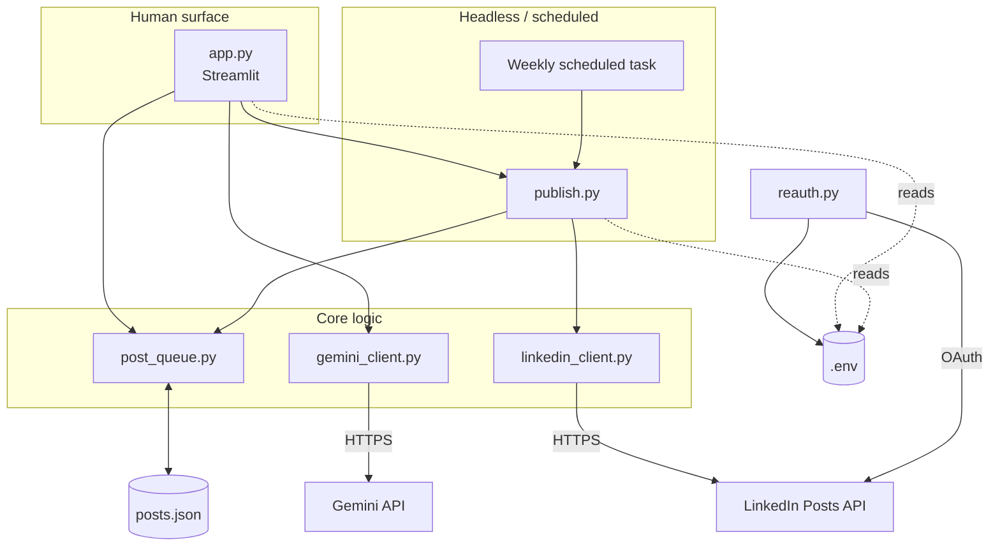
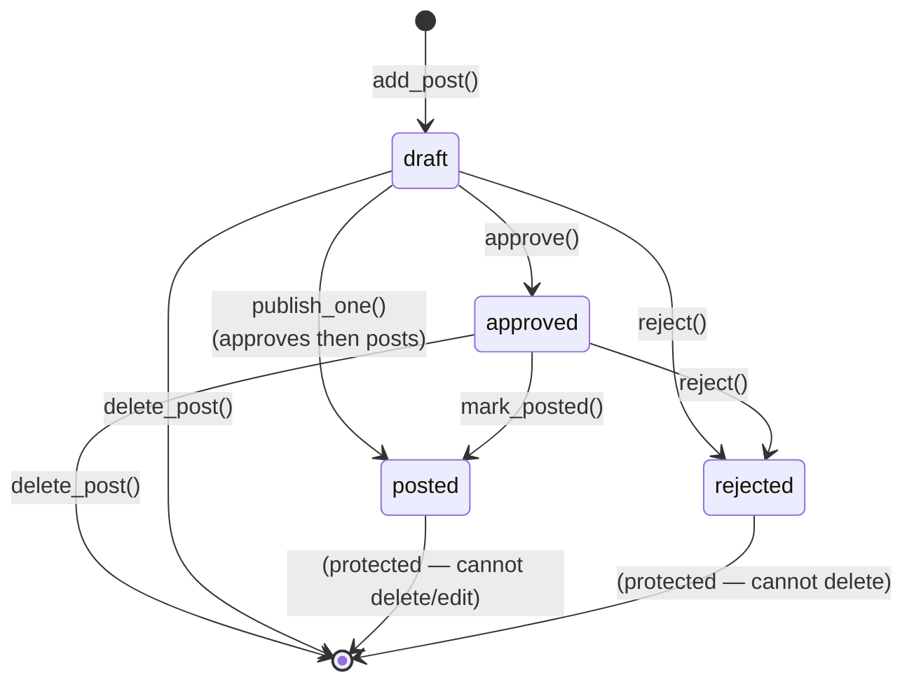
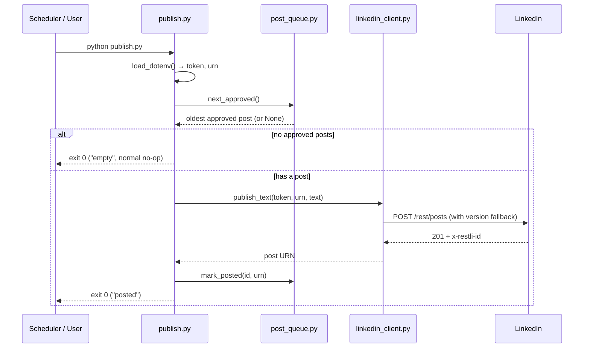

# Architecture

## Overview

GateKeep is a small, file-backed Python system with two entry points that share
one data file. There is no database and no server process beyond Streamlit — the
"queue" is a single JSON file, and every operation reads it, mutates it, and
writes it back.

This deliberate simplicity is what lets the publisher run headless from a
scheduled task with zero shared runtime state.

## Components

| File | Role | Depends on |
|---|---|---|
| `app.py` | Streamlit control panel — the only human-facing surface. Add, generate, edit, approve, reject, delete, publish-now. | `post_queue`, `gemini_client`, `linkedin_client`, `publish` |
| `publish.py` | Headless publisher. `run()` posts the oldest approved item; `publish_one()` posts a specific item on demand. Has a `main()` for the scheduled task. | `post_queue`, `linkedin_client` |
| `post_queue.py` | All read/write/query logic over `posts.json`. Owns the post schema, the status state machine, and validation. | stdlib only |
| `linkedin_client.py` | LinkedIn Posts API wrapper: builds the request, escapes commentary, handles API versioning and fallback. | `requests` |
| `gemini_client.py` | Gemini draft generation: system instruction, per-pillar prompts, and deterministic em-dash stripping. | `google-generativeai` |
| `reauth.py` | Standalone LinkedIn OAuth flow; writes `LINKEDIN_ACCESS_TOKEN` and `LINKEDIN_AUTHOR_URN` into `.env`. | `requests`, `python-dotenv` |
| `posts.json` | The single source of truth for all posts and their state. | — |
| `.env` | Secrets and config (gitignored). | — |
| `logs/publish.log` | Append-only log written by `publish.py`. | — |

### Component diagram



## Data model

`posts.json` is an object with a single `posts` array. Each post:

```json
{
  "id": "uuid4 string",
  "pillar": "build-in-public | llm-tip | career-journey | ai-take | dev-perspective | manual",
  "source": "manual | generated",
  "text": "the post body",
  "status": "draft | approved | posted | rejected",
  "created_at": "ISO-8601 UTC",
  "approved_at": "ISO-8601 UTC or null",
  "posted_at": "ISO-8601 UTC or null",
  "linkedin_post_id": "urn:li:share:... or null"
}
```

Design notes:
- **Timestamps are ISO-8601 UTC strings**, chosen so they sort chronologically
  as plain strings — `next_approved()` picks the oldest by `min()` on
  `approved_at` with no date parsing.
- **`id` is a UUID4**, generated on insert, stable for the post's lifetime.
- **The clock is injectable** (`PostQueue(path, now_fn=...)`) so tests use a
  deterministic increasing clock.
- **Reads are whole-file**: every mutation loads the file, edits in memory,
  and rewrites it with `indent=2, ensure_ascii=False`. Adequate for a
  single-user, low-volume queue.

## State machine

A post moves through four statuses. `post_queue.py` enforces every transition —
illegal moves raise `QueueError`.



Rules worth calling out:
- **Editable statuses:** `draft` and `approved`. Editing an approved post keeps
  it approved (no forced re-review) — the human already vouched for the intent.
- **Deletable statuses:** `draft` and `approved` only. `posted` and `rejected`
  are **history and are protected** from deletion and edits.
- **Approve only from draft.** Reject from draft or approved.
- **`mark_posted` only from approved** — the publisher must never mark an
  unapproved post as posted.
- **Publish-on-demand approves a draft first.** `publish_one()` treats the
  user's explicit click as the approval, so it approves a draft before posting.
  If the LinkedIn call then fails, the post is left **approved** (not draft) so
  it can be retried on the next scheduled run.

## Data flow: publishing



On a LinkedIn failure the post stays approved and `publish.py` exits non-zero
("failed"); `"empty"` is a clean exit-0 no-op.

## Key design decisions

1. **Flat JSON file, not a database.** Single user, low volume, and the
   publisher must run headless from a scheduled task. A file with no server
   removes all shared-runtime coupling between the app and the publisher.

2. **No MCP on the publish/generation paths.** `publish.py` and `app.py` talk
   to LinkedIn and Gemini directly over HTTP. Introducing an MCP integration
   would tie execution to a live Claude session and break headless scheduling.

3. **The gate is in the data model, not just the UI.** `mark_posted` refuses
   any post that is not `approved`, so even a bug in the UI cannot publish an
   unapproved post.

4. **API-version resilience for LinkedIn.** LinkedIn retires dated API versions
   (`YYYYMM`) roughly yearly. `linkedin_client.py` tries a configured version,
   then a fallback list, so a retired version degrades gracefully instead of
   hard-failing. See [api.md](api.md).

5. **Deterministic voice enforcement.** The model honors the "no em-dash" rule
   only intermittently, so `gemini_client._strip_dashes` converts em-dashes and
   spaced en-dashes to commas after generation — numeric ranges like `120-220`
   are preserved.

6. **Dual-stack OAuth callback server.** `reauth.py` binds both IPv4 and IPv6
   loopback because Windows browsers often resolve `localhost` to `::1` first;
   an IPv4-only bind would hang the callback.

## Testing

`pytest` covers the logic-heavy, non-UI paths (Streamlit UI is not unit-tested):

| Test file | Covers |
|---|---|
| `tests/test_queue.py` | Full state machine: add/approve/reject/delete/mark_posted, validation, `next_approved` ordering, history protection |
| `tests/test_publish.py` | `publish_one` and `run` — approve-then-post, empty queue, and failure-leaves-approved retry semantics (LinkedIn call mocked) |
| `tests/test_linkedin.py` | Version fallback on 426, immediate raise on other errors, commentary escaping |
| `tests/test_gemini.py` | `_strip_dashes` em-dash/en-dash handling and numeric-range preservation |

External APIs are always mocked; tests never make network calls.
