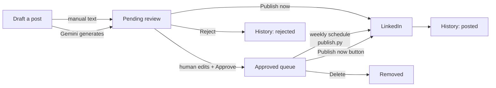

# Use Case

## The problem

Consistent LinkedIn posting builds engagement, but two things make it hard to
sustain:

1. **Discipline.** Writing a good post every week is easy to skip.
2. **Trust.** Fully automated posting is dangerous — an LLM can fabricate a
   metric, overstate a project's status, or post in a voice that does not sound
   like you. On a professional profile used for a live job search, a single bad
   post is a real cost.

GateKeep resolves the tension: it removes the friction of drafting and
scheduling while keeping a human firmly in control of what actually goes out.

## Who it is for

A single user — Panth Patel, a Software/AI Engineer relocating from Vadodara,
India to Somerset, NJ, USA and searching for US roles (Python / AI / Backend /
Full Stack). It is deliberately single-user and local: it runs on his machine,
against his LinkedIn account, with his API keys.

It is not a multi-tenant SaaS and is not designed to be one.

## What a post is about — the content pillars

Every post is tagged with a **pillar** that also drives generation. The pillars
keep output on-brand and positioned as a hireable engineer (never as a
teacher or tutorial author):

| Pillar | Subject |
|---|---|
| `build-in-public` | Progress on his real current project: an AI tool converting IONM (intraoperative neuromonitoring) machine JSON into CMS-1500 insurance-claim format |
| `llm-tip` | A real problem he hit building LLM apps (LangChain / LangGraph / AWS Bedrock) and how he worked through it |
| `career-journey` | The India-to-US relocation and job-search narrative |
| `ai-take` | His own opinion on an AI development or trend |
| `dev-perspective` | Engineer-to-engineer software takes: craft lessons, technical deep-dives, or opinions on a language/framework/tool |
| `manual` | Free-form; used only for hand-written posts, not generation |

## The core constraint: never fabricate

This project inherits a hard honesty rule from the owner's job-search work: **no
fabricated or inflated claims.** A discontinued project must be described as
discontinued, not shipped. The IONM tool is in development at ~85% accuracy — it
must never be called finished or deployed. This constraint is enforced in the
generation prompt (see [models.md](models.md)) *and* by the human approval gate.

## The end-to-end workflow

### 1. Draft

In the Streamlit app the user either:
- **Writes a manual post** — types text, picks a pillar, clicks *Add draft*, or
- **Generates one** — picks a pillar, adds optional context, clicks *Generate*.
  Gemini returns a draft that lands in the review queue.

Either way the post enters as a **draft**.

### 2. Review and approve (the gate)

Every draft — hand-written or generated — appears under **Pending review**. The
user can edit the text, then:
- **Approve** — moves it to the approved queue, ready to publish.
- **Reject** — sends it to history, never published.
- **Publish now** — a two-click confirm that approves and posts it immediately.

No post can bypass this step. This is the namesake "gate".

### 3. Publish

Two paths, both through LinkedIn's official API:
- **Scheduled (default):** a weekly Claude Code scheduled task runs
  `python publish.py`, which publishes the single **oldest approved** post. It
  runs while the app is open on the machine and catches up on next launch if the
  machine was off at trigger time.
- **On demand:** the *Publish now* button in the app, or running `publish.py`
  by hand.

A published post moves to **posted** in history with its LinkedIn post id
recorded.

## What is explicitly out of scope

- **Browser automation / scraping to post.** This violates LinkedIn's ToS.
  Publishing goes only through the official Posts API. Never build the scraping
  alternative.
- **A cloud-independent always-on agent.** The scheduler runs locally while the
  app is open; it is not a hosted service.
- **MCP-based integration on the publish path.** `publish.py` must run as a
  plain standalone script so scheduled/headless execution never depends on a
  Claude session or MCP tool availability.
- **Auto-approval or "trusted source" bypass.** The gate is unconditional.
